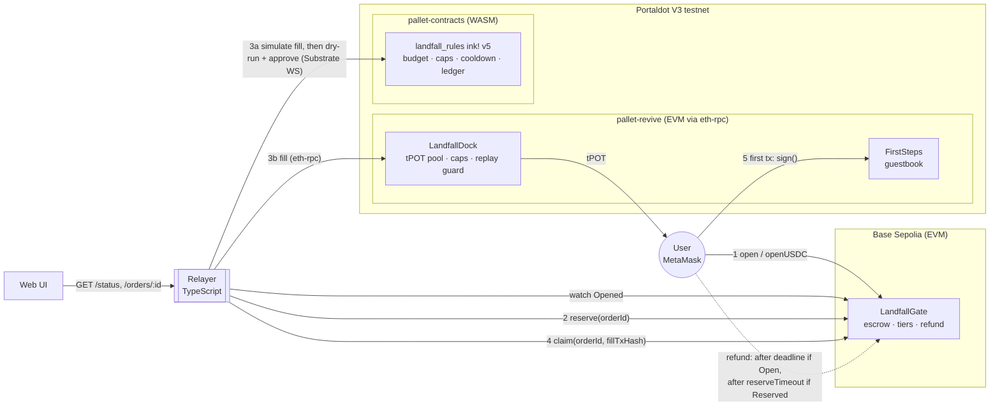
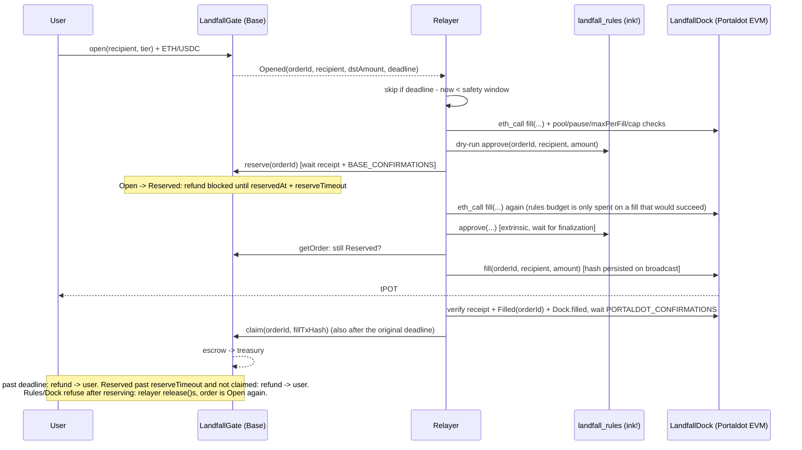

# ⛴ Landfall — gas onboarding into Portaldot

**Pay on Base Sepolia, receive tPOT gas on Portaldot, make your first Portaldot transaction.**

Built for Portaldot Hacker House 2026, Multi-Chain & Cross-Chain track.

---

## Why

New users can't do anything on Portaldot's V3 testnet until someone sends them tPOT. tPOT is minted by admins only and there is no public faucet, so a developer arriving from another ecosystem with a funded EVM wallet is stuck at zero balance. At the time of writing there is also no bridge or other cross-chain way into Portaldot.

Landfall closes that gap with an **intent bridge**, the same model as Across:

1. The user opens an order on **Base Sepolia** and pays a fixed tier price in ETH or test USDC. The payment stays in escrow in `LandfallGate`.
2. A **relayer** sees the order and **reserves** it on Base. From then on the order cannot be refunded until the reservation times out (default 24 h), so a fill can no longer race a deadline refund.
3. The relayer records an approval in the **ink! rules contract** (WASM, `pallet-contracts`), then pays tPOT to the user's Portaldot address from the **LandfallDock** pool (EVM, `pallet-revive`).
4. The relayer **claims** the escrow on Base, citing the Portaldot fill transaction hash. A reserved order can be claimed after its original deadline.
5. If nobody reserves the order before its deadline, **anyone can refund it** on Base. If it was reserved but never claimed, anyone can refund it once the reservation times out. Either way the user gets the full payment back.

The demo ends when the user's Portaldot address, which started at 0 tPOT, signs the on-chain `FirstSteps` guestbook. That is its first Portaldot transaction.

## Architecture





### Why both VMs?

Portaldot runs two contract environments side by side, and Landfall uses each for the job it fits:

- The **EVM side (`pallet-revive`) holds the balances.** `LandfallDock` is a plain Solidity contract that keeps the tPOT pool and pays users with a native value transfer. Users and MetaMask talk to it like any EVM chain, and `FirstSteps` lives here so the first transaction is an ordinary MetaMask signature.
- The **WASM side (`pallet-contracts`, ink! v5) holds the rules and the audit ledger.** `landfall_rules` enforces a global daily budget, a lifetime cap per recipient, a per-recipient cooldown and a pause switch. It rejects duplicate order ids and stores every approval with its block number and timestamp, so the policy and its history can be read on-chain.

**The runtime has no direct cross-VM call.** A Solidity contract in `pallet-revive` cannot synchronously call an ink! contract in `pallet-contracts`, and the reverse is also impossible. The **relayer bridges the two VMs**: it must get an `approve` finalized on the ink! contract (or included, with `RULES_FINALITY=inblock`) before it calls `LandfallDock.fill`. Before spending rules budget it simulates the Dock fill (`eth_call` from the relayer address plus explicit pool, pause, `maxPerFill` and recipient-cap checks), so an approval is only recorded for a fill that would succeed. That ordering is enforced by the relayer, not by the chain. The rules contract is a policy gate and a public ledger for the operator. It is not a trustless lock on the Dock. `LandfallDock` has its own on-chain backstops (`maxPerFill`, `recipientCap`, replay guard, pause), so a misbehaving or compromised relayer is still limited by the EVM contract itself.

## Trust model and risks

Landfall is an intent bridge with a **trusted, operator-run filler**. Who carries which risk:

| Party | Trusts | Protected by |
|---|---|---|
| User | that the relayer fills an order it reserved | An order that is never reserved can be refunded by anyone after its deadline. A reserved order can be refunded by anyone after `reservedAt + reserveTimeout` (default 24 h, owner-set, 1 h to 30 days). Every order settles exactly once: `claim` needs `Reserved`, and both `claim` and `refund` change the status (fuzz-tested). **The user is never worse off than a delayed refund**: the worst case is a relayer that reserves and disappears, which delays the refund by at most the reservation timeout. |
| Relayer / operator | nothing on Base: it fills first, then claims | It reserves before filling, so the user cannot refund while it fills, and a reserved order can be claimed **also after the original deadline**. The relayer **must claim within `reserveTimeout`**: once it passes, anyone can refund, and if that happens after the fill the operator eats the loss. The relayer never fills an order it has not reserved, re-reads the Gate right before the fill, and does not start a fill with less than `SAFETY_WINDOW_SEC` left on the reservation (it releases instead). Reserved or paid orders are never abandoned by retry limits. |
| tPOT pool | the relayer key | Dock limits: `maxPerFill`, lifetime `recipientCap`, replay guard on order id, `pause`, and owner-only `withdraw`. The ink! rules add a daily budget and cooldown, enforced as long as the relayer follows them. |

Gate order states: `Open` → `Reserved` (relayer, while `now + reserveSafety <= deadline`) → `Filled` (relayer claim, any time while reserved). `Open` → `Refunded` after the deadline. `Reserved` → `Refunded` after the reservation timeout. `Reserved` → `Open` when the relayer `release`s an order it will not fill (rules or Dock refused it), which puts the user back on the normal deadline instead of the reservation timeout.

Other risks and limitations, stated plainly:

- **Centralisation.** One relayer key signs on both chains. The owner can rotate it (`setRelayer` on Gate and Dock, `set_relayer` on rules). Gate, Dock and the ink! rules all use two-step ownership transfer (`Ownable2Step`; `transfer_ownership` + `accept_ownership` on rules), and the rules reject the zero account as relayer or owner.
- **Reservation timeout is owner-set.** `setReserveTimeout` applies to existing reservations too. It is bounded to 1 h – 30 days, and the owner is already trusted (it can rotate the relayer).
- **Refund to a reverting user.** `refund` pushes ETH to the order's `user`. A contract wallet that reverts on receive cannot be refunded in ETH (the call reverts and the order stays refundable). Acceptable on testnet; a pull-payment pattern would fix it.
- **Retries.** Before an order is reserved, `MAX_ATTEMPTS` failures mark it `failed` (the user refunds after the deadline). Once it is reserved or a fill tx exists, failures are logged as `SETTLEMENT RECOVERY` errors and retried forever with exponential backoff (`RETRY_BACKOFF_MS` … `RETRY_BACKOFF_MAX_MS`). Reserve, fill and claim tx hashes are written to the state file the moment they are broadcast.
- **The fill reference is not proven on Base.** `claim(orderId, fillTxRef)` records the Portaldot tx hash for auditability, but Base cannot verify it. A dishonest relayer could claim without filling, and users would see that on Portaldot (no `Filled` event for the order). Removing this trust needs a light client or an oracle (see roadmap).
- **Pause semantics.** Pausing `LandfallGate` blocks only new orders. Reserve, release, claim and refund keep working so in-flight orders always settle. Pausing `LandfallDock` or the rules stops fills: unreserved orders become refundable after their deadline; a reserved order is retried until less than `SAFETY_WINDOW_SEC` is left on its reservation, then released (refundable at its deadline) or, if the relayer is down, refundable after the reservation timeout.
- **Units.** The EVM side of Portaldot shows 18 decimals. Native tPOT has 14, and `pallet-revive` scales by 10⁴. `LandfallGate.setTier` rejects tier amounts that are not multiples of 10⁴ wei, so the conversion never truncates. The ink! rules work in native 14-decimal units, and the relayer converts (`amount / 10^4`). The rules defaults (daily budget 10¹⁷ = 1000 tPOT, recipient cap 3·10¹⁵ = 30 tPOT, 14 decimals) are separate from the Dock limits (20 tPOT per fill, 30 tPOT per recipient, 18 decimals).
- **Payment tokens.** `openUSDC` checks the received balance and rejects fee-on-transfer tokens. Each order remembers its token, so changing `paymentToken` never strands escrow.
- **Unmapped accounts.** In `pallet-revive`, an unmapped H160 has the fallback AccountId32 `h160 ++ 0xEE*12`. tPOT that `LandfallDock` sends to a fresh EVM address lands on that fallback account, and that is the same account the address signs from through eth-rpc. The first-tx demo relies on this: the new address pays for `FirstSteps.sign` with no mapping step. The local e2e checks this flow on anvil; it has not yet been run against the live testnet in this repo. Native Substrate accounts that want to use the EVM side can call `Revive.map_account`.
- Testnet software, **not audited**.

## Repository layout

```
contracts/evm/            Foundry project
  src/LandfallGate.sol         Base Sepolia escrow: tiers, open/openUSDC, reserve/release, claim, refund, pause
  src/LandfallDock.sol         Portaldot EVM tPOT pool: fill with replay guard, filledAt, caps, pause
  src/FirstSteps.sol        Portaldot EVM guestbook for the first transaction
  test/                     forge tests (unit + fuzz), mock ERC20s
  script/                   forge deploy scripts (DeployGate, DeployPortaldot)
contracts/ink/landfall_rules/ ink! v5 policy + audit ledger (lib.rs, unit tests, artifacts/)
relayer/                  TypeScript relayer (viem + polkadot-js), JSON state, /status server
web/                      Vite + React + viem UI
scripts/deploy-rules.ts   polkadot-js deploy script for the ink! contract
scripts/e2e/              two-anvil end-to-end test
```

## Run locally

Prerequisites: [Foundry](https://getfoundry.sh) (forge/anvil), Node.js ≥ 24 (developed on 26; the relayer and scripts run TypeScript natively, with no build step), and Rust. Building the ink! contract also needs `cargo-contract` 5.x:

```bash
cargo install cargo-contract --version ^5 --locked
```

`contracts/ink/landfall_rules/rust-toolchain.toml` pins Rust 1.89. cargo-contract 5 builds `core` with the `panic_immediate_abort` feature, which newer rustc releases removed. Prebuilt artifacts (`.contract`, `.json`, `.wasm`) are committed under `contracts/ink/landfall_rules/artifacts/`.

```bash
make deps          # git submodules (forge-std, OpenZeppelin) + npm install
make test          # forge tests + ink! unit tests + relayer unit tests + e2e   (same as: npm test)
```

Individual suites: `make test-evm`, `make test-ink`, `make test-relayer`, `make test-e2e`, `make build-ink`.

### The e2e test

`scripts/e2e/run.ts` starts **two anvil instances**: one mocks Base (chain 31337) and one mocks Portaldot's EVM (chain 31338). It deploys with the real forge scripts and runs the relayer as a child process with `RULES_MODE=off`, because the ink! step needs a Substrate node. It checks:

The "Portaldot" anvil runs with a 1 s block time so the relayer's default `PORTALDOT_CONFIRMATIONS=2` is exercised.

1. `--dry-run --once` simulates everything and sends nothing (not even a reservation).
2. ETH order: opened → reserved → filled on "Portaldot" → claimed on "Base". The claim references a real fill tx, and the reservation happened before the fill.
3. The recipient, which started at **0**, signs `FirstSteps` with the received gas.
4. `/status` reports pool balance, order counts and recent fills.
5. USDC order: filled, and the treasury receives USDC.
6. Dock recipient-cap rejection is caught before reserving: nothing is reserved or filled, the deadline passes, and the user gets a full refund.
7. Relayer restart: it resumes from the state file without double-filling, skips an order inside the safety window, and the user refunds it.
8. The relayer is killed between fill and claim and restarted after the original deadline: the user cannot refund the reserved order, and the claim still succeeds with no second fill.
9. Same crash plus a deleted state file: the relayer rebuilds from `GATE_DEPLOY_BLOCK`, finds the fill through `Dock.filledAt` and claims once.
10. An order reserved but never filled: refund reverts with `ReservationActive` until the reservation timeout, then succeeds.

### Relayer

```bash
cp .env.example .env     # fill in addresses + throwaway testnet keys
npm run relayer          # or: npm --workspace relayer run dry-run
```

- Watches `Opened` on LandfallGate in chunks, with `BASE_CONFIRMATIONS` confirmations. The first scan starts at `GATE_DEPLOY_BLOCK` (required), so a new or lost state file rebuilds every order from events plus current Gate state.
- Per order: checks on-chain truth first → skips if inside the safety window → simulates the Dock fill and dry-runs the rules → `reserve` on Base (waits for the receipt and `BASE_CONFIRMATIONS`) → simulates the Dock fill again → ink! `approve`, waiting for finalization (`RULES_FINALITY`) → re-reads the Gate (must still be `Reserved`) → `LandfallDock.fill` → verifies the fill (receipt success, `Filled(orderId)` from the Dock, `Dock.filled`) and waits `PORTALDOT_CONFIRMATIONS` (default 2) → `LandfallGate.claim(orderId, fillTxHash)`. If the rules or the Dock refuse after reserving, it calls `release` so the user is back on the normal deadline.
- Idempotent. A JSON state file is written atomically, and tx hashes are stored as soon as they are broadcast. On restart it resumes from the last scanned block, re-reads the rules approval from chain (`approval(order_id)` against the finalized head) instead of trusting the stored extrinsic hash, and never trusts a stored fill hash on its own: the fill is re-verified, a dropped or reverted fill is sent again (the Dock's replay guard makes that safe), and a fill made by another tx is located through `Dock.filledAt` (falling back to `eth_getLogs` in `PORTALDOT_LOG_CHUNK` blocks).
- Gas is never hardcoded: viem asks each node for estimates. Portaldot estimates are very large numbers.
- Logs are structured JSON lines. `--dry-run` sends nothing and writes no state file. `--once` runs a single pass.
- HTTP: `GET /status` (pool balance, rules budget left today, order counts, recent fills), `GET /orders/:orderId`, `GET /healthz`.

### Web UI

```bash
npm run web              # Vite dev server; reads VITE_* from the repo-root .env
```

Connect MetaMask → see Base ETH/USDC and Portaldot tPOT balances → pick a tier → pay in ETH or USDC → follow the live timeline (**Opened → Reserved → Approved by rules (WASM) → Filled on Portaldot → Claimed**) with tx references → once the order is refundable (deadline passed while open, or reservation timed out), a **Refund** button appears → **Make your first Portaldot tx** adds the Portaldot network to MetaMask and signs `FirstSteps`.

## Deploy

All keys come from environment variables (`.env`, git-ignored). Never commit keys.

1. **Base Sepolia: LandfallGate**
   ```bash
   make deploy-base     # forge script DeployGate: RELAYER_ADDRESS, TREASURY_ADDRESS, PAYMENT_TOKEN (default Circle test USDC 0x036C…CF7e), ORDER_TTL, RESERVE_SAFETY, RESERVE_TIMEOUT
   ```
   The script prints `GATE_DEPLOY_BLOCK` (also written to `deployments/gate-<chainId>.json`); the relayer needs it. Default tiers: 0.5 USDC / 0.0002 ETH → 2 tPOT, 1 USDC / 0.0005 ETH → 5 tPOT, 2 USDC / 0.001 ETH → 12 tPOT. Override them with `TIER{n}_PRICE_WEI`, `TIER{n}_PRICE_TOKEN` and `TIER{n}_DST`.
2. **Portaldot EVM: LandfallDock + FirstSteps**
   ```bash
   make deploy-portaldot   # forge script DeployPortaldot via https://test-evm-rpc-v3.portaldot.dev (chain 420420777), --legacy, no fixed gas limit
   ```
   The script prints `DOCK_DEPLOY_BLOCK`.
   Fund the pool by sending tPOT to the Dock (`receive()`), or set `DOCK_INITIAL_FUND`.
3. **Portaldot WASM: landfall_rules**
   ```bash
   make build-ink          # optional; artifacts are committed
   make deploy-rules       # polkadot-js: wss://test-node-v3.portaldot.dev, RULES_DEPLOYER_SURI, RULES_RELAYER_SS58, budget/cap/cooldown
   ```
   `deploy-rules.ts --dry-run` asks the node for the weight and storage deposit without submitting.
4. Fill in `GATE_ADDRESS`, `GATE_DEPLOY_BLOCK`, `DOCK_ADDRESS`, `DOCK_DEPLOY_BLOCK`, `RULES_ADDRESS` and `VITE_*` in `.env`, fund the relayer with Base Sepolia ETH and some tPOT (EVM side for `fill`, Substrate side for `approve`), then run `npm run relayer` and `npm run web`.

## Deployments

| Contract | Network | Address | Deploy tx |
|---|---|---|---|
| LandfallGate | Base Sepolia (84532) | `TBD` | `TBD` |
| LandfallDock | Portaldot V3 EVM (420420777) | `TBD` | `TBD` |
| FirstSteps | Portaldot V3 EVM (420420777) | `TBD` | `TBD` |
| landfall_rules (ink!) | Portaldot V3 WASM (ss58 42) | `TBD` | `TBD` |

| Demo step | Tx |
|---|---|
| Order opened on Base | `TBD` |
| Rules approval (ink!) | `TBD` |
| Fill on Portaldot | `TBD` |
| Claim on Base | `TBD` |
| First Portaldot tx (FirstSteps.sign) | `TBD` |

## Roadmap

- Verify fills on Base trustlessly with a Portaldot light-client or oracle proof of the `Filled` event, replacing the trusted `fillTxRef`.
- Multiple competing relayers with bonds and slashing, plus a relayer fee market instead of fixed tiers.
- More source chains (Ethereum Sepolia, Arbitrum Sepolia, OP Sepolia) through one Gate per chain. Order ids already include the chain id and gate address.
- A precompile or XCM-style hook so `LandfallDock` can check `landfall_rules` on-chain once the runtime supports cross-VM calls.
- Gasless open via ERC-2612 / Permit2 for USDC.
- Mainnet POT once the token is live, with an external security review.

## Credits

| Library / tool | Use | License |
|---|---|---|
| [OpenZeppelin Contracts](https://github.com/OpenZeppelin/openzeppelin-contracts) v5.1 | Ownable2Step, Pausable, ReentrancyGuard, SafeERC20, ERC20 (tests) | MIT |
| [forge-std](https://github.com/foundry-rs/forge-std) | test and script helpers | MIT / Apache-2.0 |
| [Foundry](https://github.com/foundry-rs/foundry) | build, test, deploy, anvil | MIT / Apache-2.0 |
| [ink!](https://github.com/use-ink/ink) v5 | WASM smart contract language | Apache-2.0 |
| [cargo-contract](https://github.com/use-ink/cargo-contract) | ink! build tool (not redistributed) | GPL-3.0 |
| [viem](https://github.com/wevm/viem) | EVM client in relayer, web, e2e | MIT |
| [polkadot-js api / api-contract / keyring / util-crypto](https://github.com/polkadot-js/api) | Substrate and ink! client | Apache-2.0 |
| [React](https://github.com/facebook/react) | UI | MIT |
| [Vite](https://github.com/vitejs/vite) + [@vitejs/plugin-react](https://github.com/vitejs/vite-plugin-react) | web build | MIT |
| [TypeScript](https://github.com/microsoft/TypeScript) | types | Apache-2.0 |

Landfall's own code is released under the [MIT License](LICENSE).
