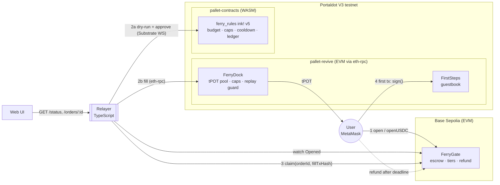
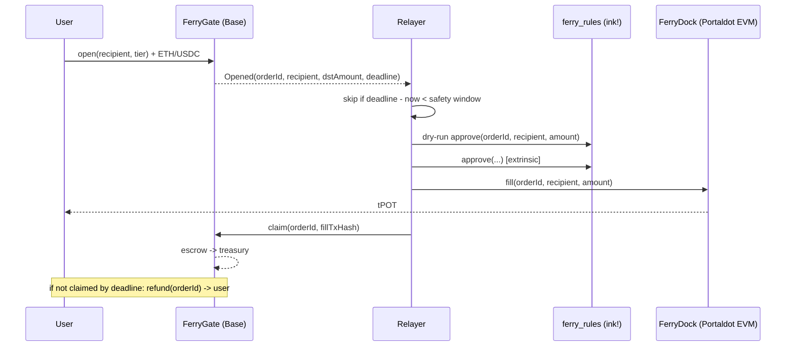

# ⛴ Ferry — gas onboarding into Portaldot

**Pay on Base Sepolia, receive tPOT gas on Portaldot, make your first Portaldot transaction.**

Built for Portaldot Hacker House 2026, Multi-Chain & Cross-Chain track.

---

## Why

New users can't do anything on Portaldot's V3 testnet until someone sends them tPOT. tPOT is minted by admins only and there is no public faucet, so a developer arriving from another ecosystem with a funded EVM wallet is stuck at zero balance. At the time of writing there is also no bridge or other cross-chain way into Portaldot.

Ferry closes that gap with an **intent bridge**, the same model as Across:

1. The user opens an order on **Base Sepolia** and pays a fixed tier price in ETH or test USDC. The payment stays in escrow in `FerryGate`.
2. A **relayer** sees the order. It records an approval in the **ink! rules contract** (WASM, `pallet-contracts`), then pays tPOT to the user's Portaldot address from the **FerryDock** pool (EVM, `pallet-revive`).
3. The relayer **claims** the escrow on Base, citing the Portaldot fill transaction hash.
4. If nobody fills the order before its deadline, **anyone can refund it** on Base, and the user gets their payment back.

The demo ends when the user's Portaldot address, which started at 0 tPOT, signs the on-chain `FirstSteps` guestbook. That is its first Portaldot transaction.

## Architecture





### Why both VMs?

Portaldot runs two contract environments side by side, and Ferry uses each for the job it fits:

- The **EVM side (`pallet-revive`) holds the balances.** `FerryDock` is a plain Solidity contract that keeps the tPOT pool and pays users with a native value transfer. Users and MetaMask talk to it like any EVM chain, and `FirstSteps` lives here so the first transaction is an ordinary MetaMask signature.
- The **WASM side (`pallet-contracts`, ink! v5) holds the rules and the audit ledger.** `ferry_rules` enforces a global daily budget, a lifetime cap per recipient, a per-recipient cooldown and a pause switch. It rejects duplicate order ids and stores every approval with its block number and timestamp, so the policy and its history can be read on-chain.

**The runtime has no direct cross-VM call.** A Solidity contract in `pallet-revive` cannot synchronously call an ink! contract in `pallet-contracts`, and the reverse is also impossible. The **relayer bridges the two VMs**: it must get an `approve` included on the ink! contract before it calls `FerryDock.fill`. That ordering is enforced by the relayer, not by the chain. The rules contract is a policy gate and a public ledger for the operator. It is not a trustless lock on the Dock. `FerryDock` has its own on-chain backstops (`maxPerFill`, `recipientCap`, replay guard, pause), so a misbehaving or compromised relayer is still limited by the EVM contract itself.

## Trust model and risks

Ferry is an intent bridge with a **trusted, operator-run filler**. Who carries which risk:

| Party | Trusts | Protected by |
|---|---|---|
| User | that the relayer fills before the deadline | `FerryGate.refund` lets anyone return the full escrow to the user after the deadline. Claims are impossible after the deadline, so funds can never be both claimed and refunded (fuzz-tested). |
| Relayer / operator | nothing on Base: it fills first, then claims | It takes the **timing risk**. If it fills but its claim lands after the deadline, the user can refund and the operator loses the tPOT. The relayer mitigates this with a safety window: it skips orders whose deadline is less than `SAFETY_WINDOW_SEC` (default 300 s) away. |
| tPOT pool | the relayer key | Dock limits: `maxPerFill`, lifetime `recipientCap`, replay guard on order id, `pause`, and owner-only `withdraw`. The ink! rules add a daily budget and cooldown, enforced as long as the relayer follows them. |

Other risks and limitations, stated plainly:

- **Centralisation.** One relayer key signs on both chains. The owner can rotate it (`setRelayer` on Gate and Dock, `set_relayer` on rules). Gate and Dock use two-step ownership transfer (`Ownable2Step`).
- **The fill reference is not proven on Base.** `claim(orderId, fillTxRef)` records the Portaldot tx hash for auditability, but Base cannot verify it. A dishonest relayer could claim without filling, and users would see that on Portaldot (no `Filled` event for the order). Removing this trust needs a light client or an oracle (see roadmap).
- **Pause semantics.** Pausing `FerryGate` blocks only new orders. Claims and refunds keep working so in-flight orders always settle. Pausing `FerryDock` or the rules stops fills, and affected orders become refundable after their deadline.
- **Units.** The EVM side of Portaldot shows 18 decimals. Native tPOT has 14, and `pallet-revive` scales by 10⁴. Tier amounts should be multiples of 10⁴ wei. The ink! rules work in native 14-decimal units, and the relayer converts (`amount / 10^4`).
- **Payment tokens.** `openUSDC` checks the received balance and rejects fee-on-transfer tokens. Each order remembers its token, so changing `paymentToken` never strands escrow.
- **Unmapped accounts.** In `pallet-revive`, an unmapped H160 has the fallback AccountId32 `h160 ++ 0xEE*12`. tPOT that `FerryDock` sends to a fresh EVM address lands on that fallback account, and that is the same account the address signs from through eth-rpc. The first-tx demo relies on this: the new address pays for `FirstSteps.sign` with no mapping step. The local e2e checks this flow on anvil; it has not yet been run against the live testnet in this repo. Native Substrate accounts that want to use the EVM side can call `Revive.map_account`.
- Testnet software, **not audited**.

## Repository layout

```
contracts/evm/            Foundry project
  src/FerryGate.sol         Base Sepolia escrow: tiers, open/openUSDC, claim, refund, pause
  src/FerryDock.sol         Portaldot EVM tPOT pool: fill with replay guard, caps, pause
  src/FirstSteps.sol        Portaldot EVM guestbook for the first transaction
  test/                     forge tests (unit + fuzz), mock ERC20s
  script/                   forge deploy scripts (DeployGate, DeployPortaldot)
contracts/ink/ferry_rules/ ink! v5 policy + audit ledger (lib.rs, unit tests, artifacts/)
relayer/                  TypeScript relayer (viem + polkadot-js), JSON state, /status server
web/                      Vite + React + viem UI
scripts/deploy-rules.ts   polkadot-js deploy script for the ink! contract
scripts/e2e/              two-anvil end-to-end test
```

## Run locally

Prerequisites: [Foundry](https://getfoundry.sh) (forge/anvil), Node.js ≥ 24 (developed on 26; the relayer and scripts run TypeScript natively, with no build step), and Rust. Building the ink! contract also needs `cargo-contract` 5.x:

```bash
cargo install cargo-contract --version ^5 --locked
```

`contracts/ink/ferry_rules/rust-toolchain.toml` pins Rust 1.89. cargo-contract 5 builds `core` with the `panic_immediate_abort` feature, which newer rustc releases removed. Prebuilt artifacts (`.contract`, `.json`, `.wasm`) are committed under `contracts/ink/ferry_rules/artifacts/`.

```bash
make deps          # git submodules (forge-std, OpenZeppelin) + npm install
make test          # forge tests + ink! unit tests + relayer unit tests + e2e   (same as: npm test)
```

Individual suites: `make test-evm`, `make test-ink`, `make test-relayer`, `make test-e2e`, `make build-ink`.

### The e2e test

`scripts/e2e/run.ts` starts **two anvil instances**: one mocks Base (chain 31337) and one mocks Portaldot's EVM (chain 31338). It deploys with the real forge scripts and runs the relayer as a child process with `RULES_MODE=off`, because the ink! step needs a Substrate node. It checks:

1. `--dry-run --once` simulates everything and sends nothing.
2. ETH order: opened → filled on "Portaldot" → claimed on "Base". The claim references a real fill tx.
3. The recipient, which started at **0**, signs `FirstSteps` with the received gas.
4. `/status` reports pool balance, order counts and recent fills.
5. USDC order: filled, and the treasury receives USDC.
6. Dock recipient-cap rejection: nothing is filled, the deadline passes, and the user gets a full refund.
7. Relayer restart: it resumes from the state file without double-filling, skips an order inside the safety window, and the user refunds it.

### Relayer

```bash
cp .env.example .env     # fill in addresses + throwaway testnet keys
npm run relayer          # or: npm --workspace relayer run dry-run
```

- Watches `Opened` on FerryGate in chunks, with `BASE_CONFIRMATIONS` confirmations.
- Per order: checks on-chain truth first → skips if inside the safety window → dry-runs then submits ink! `approve` → simulates then sends `FerryDock.fill` → sends `FerryGate.claim(orderId, fillTxHash)`.
- Idempotent. A JSON state file is written atomically. On restart it resumes from the last scanned block and recovers a fill that was sent but not yet recorded, using `Dock.filled` and the `Filled` event. It never refills a recorded order.
- Gas is never hardcoded: viem asks each node for estimates. Portaldot estimates are very large numbers.
- Logs are structured JSON lines. `--dry-run` sends nothing and writes no state file. `--once` runs a single pass.
- HTTP: `GET /status` (pool balance, rules budget left today, order counts, recent fills), `GET /orders/:orderId`, `GET /healthz`.

### Web UI

```bash
npm run web              # Vite dev server; reads VITE_* from the repo-root .env
```

Connect MetaMask → see Base ETH/USDC and Portaldot tPOT balances → pick a tier → pay in ETH or USDC → follow the live timeline (**Opened → Approved by rules (WASM) → Filled on Portaldot → Claimed**) with tx references → if the deadline passes, a **Refund** button appears → **Make your first Portaldot tx** adds the Portaldot network to MetaMask and signs `FirstSteps`.

## Deploy

All keys come from environment variables (`.env`, git-ignored). Never commit keys.

1. **Base Sepolia: FerryGate**
   ```bash
   make deploy-base     # forge script DeployGate: RELAYER_ADDRESS, TREASURY_ADDRESS, PAYMENT_TOKEN (default Circle test USDC 0x036C…CF7e), ORDER_TTL
   ```
   Default tiers: 0.5 USDC / 0.0002 ETH → 2 tPOT, 1 USDC / 0.0005 ETH → 5 tPOT, 2 USDC / 0.001 ETH → 12 tPOT. Override them with `TIER{n}_PRICE_WEI`, `TIER{n}_PRICE_TOKEN` and `TIER{n}_DST`.
2. **Portaldot EVM: FerryDock + FirstSteps**
   ```bash
   make deploy-portaldot   # forge script DeployPortaldot via https://test-evm-rpc-v3.portaldot.dev (chain 420420777), --legacy, no fixed gas limit
   ```
   Fund the pool by sending tPOT to the Dock (`receive()`), or set `DOCK_INITIAL_FUND`.
3. **Portaldot WASM: ferry_rules**
   ```bash
   make build-ink          # optional; artifacts are committed
   make deploy-rules       # polkadot-js: wss://test-node-v3.portaldot.dev, RULES_DEPLOYER_SURI, RULES_RELAYER_SS58, budget/cap/cooldown
   ```
   `deploy-rules.ts --dry-run` asks the node for the weight and storage deposit without submitting.
4. Fill in `GATE_ADDRESS`, `DOCK_ADDRESS`, `RULES_ADDRESS` and `VITE_*` in `.env`, fund the relayer with Base Sepolia ETH and some tPOT (EVM side for `fill`, Substrate side for `approve`), then run `npm run relayer` and `npm run web`.

## Deployments

| Contract | Network | Address | Deploy tx |
|---|---|---|---|
| FerryGate | Base Sepolia (84532) | `TBD` | `TBD` |
| FerryDock | Portaldot V3 EVM (420420777) | `TBD` | `TBD` |
| FirstSteps | Portaldot V3 EVM (420420777) | `TBD` | `TBD` |
| ferry_rules (ink!) | Portaldot V3 WASM (ss58 42) | `TBD` | `TBD` |

| Demo step | Tx |
|---|---|
| Order opened on Base | `TBD` |
| Rules approval (ink!) | `TBD` |
| Fill on Portaldot | `TBD` |
| Claim on Base | `TBD` |
| First Portaldot tx (FirstSteps.sign) | `TBD` |

## Roadmap

- Verify fills on Base trustlessly with a Portaldot light-client or oracle proof of the `Filled` event, replacing the trusted `fillTxRef`.
- Multiple competing relayers with bonds and slashing, plus a relayer fee market instead of fixed tiers.
- More source chains (Ethereum Sepolia, Arbitrum Sepolia, OP Sepolia) through one Gate per chain. Order ids already include the chain id and gate address.
- A precompile or XCM-style hook so `FerryDock` can check `ferry_rules` on-chain once the runtime supports cross-VM calls.
- Gasless open via ERC-2612 / Permit2 for USDC.
- Mainnet POT once the token is live, with an external security review.

## Credits

| Library / tool | Use | License |
|---|---|---|
| [OpenZeppelin Contracts](https://github.com/OpenZeppelin/openzeppelin-contracts) v5.1 | Ownable2Step, Pausable, ReentrancyGuard, SafeERC20, ERC20 (tests) | MIT |
| [forge-std](https://github.com/foundry-rs/forge-std) | test and script helpers | MIT / Apache-2.0 |
| [Foundry](https://github.com/foundry-rs/foundry) | build, test, deploy, anvil | MIT / Apache-2.0 |
| [ink!](https://github.com/use-ink/ink) v5 | WASM smart contract language | Apache-2.0 |
| [cargo-contract](https://github.com/use-ink/cargo-contract) | ink! build tool (not redistributed) | GPL-3.0 |
| [viem](https://github.com/wevm/viem) | EVM client in relayer, web, e2e | MIT |
| [polkadot-js api / api-contract / keyring / util-crypto](https://github.com/polkadot-js/api) | Substrate and ink! client | Apache-2.0 |
| [React](https://github.com/facebook/react) | UI | MIT |
| [Vite](https://github.com/vitejs/vite) + [@vitejs/plugin-react](https://github.com/vitejs/vite-plugin-react) | web build | MIT |
| [TypeScript](https://github.com/microsoft/TypeScript) | types | Apache-2.0 |

Ferry's own code is released under the [MIT License](LICENSE).
